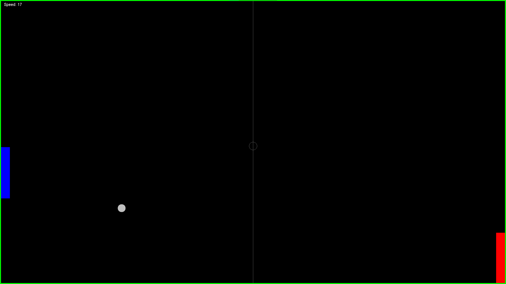

# 2D Retro Pong Game

A classic 2D Pong arcade game built from scratch using **Java** without external game engines or frameworks. Built to practice Object-Oriented Programming, custom 2D graphics with Java Swing/AWT, custom physics, and multithreaded game loops.

## Gameplay Preview

## Controls

Local 2-player matches on a single keyboard:

| Player | Action | Key |
| :--- | :--- | :--- |
| **Player 1 (Left)** | Move Up / Down | `W` / `S` |
| **Player 2 (Right)** | Move Up / Down | `↑` / `↓` |
| **Global** | Start / Reset Round | `Enter` or `Space` |
| **Global** | Exit | `Esc` |

## Core Concepts

* **Object-Oriented Programming**: Core entities (`Ball`, `Paddle`, `Score`) extend `java.awt.Rectangle`. Window components extend `JFrame` and `JPanel`. Separated into `ui` and `game` packages. Implements `Runnable` and `ActionListener`.
* **Game Loop**: A dedicated `Thread` runs game updates (`move()`, `checkCollision()`) separately from UI repainting to keep inputs responsive.
* **Physics & Collisions**: Uses rectangular intersection checks (`intersects()`). Ball speed increases slightly with each paddle hit. Screen boundaries bounce the ball vertically.
* **Double Buffering**: Renders graphics to an off-screen buffer before drawing to the screen to eliminate flickering.
* **Input**: Uses a `KeyAdapter` to track key press and release states for smooth paddle movement.

## Tech Stack

* **Language**: Java (JDK 17+)
* **GUI & Graphics**: `javax.swing.*`, `java.awt.*`
* **Events**: `java.awt.event.*`
* **IDE**: Visual Studio Code
